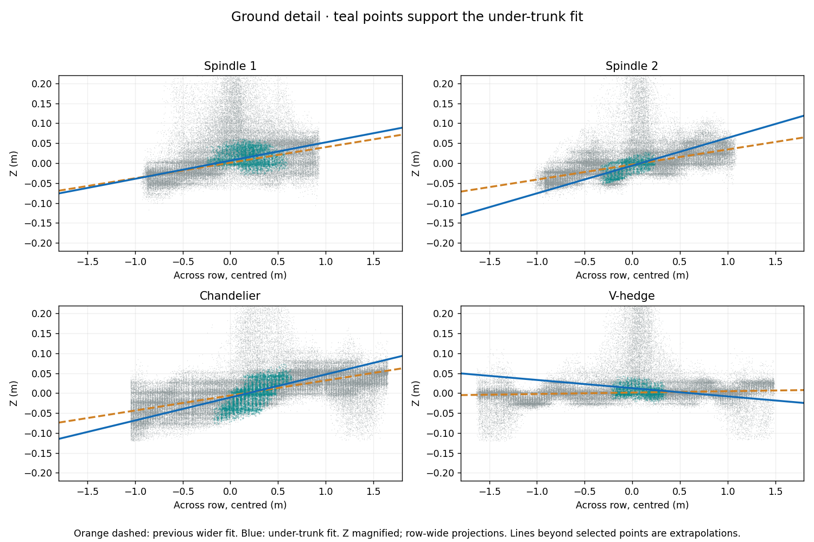
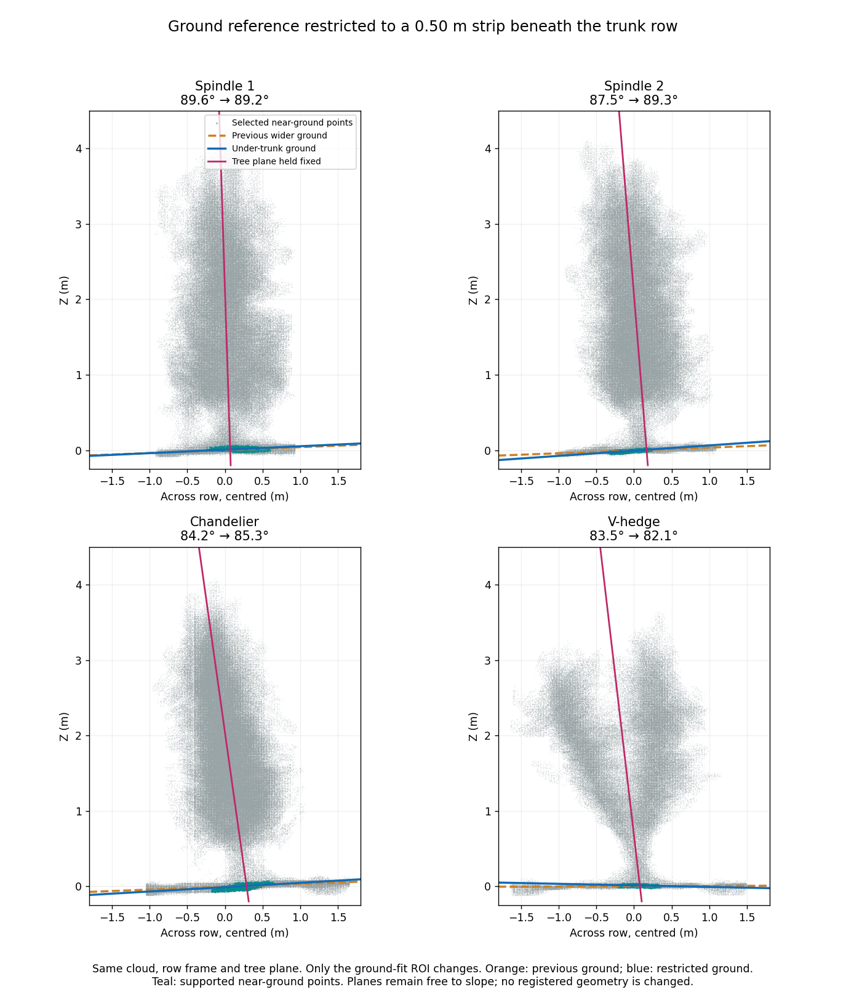

# Ground plane fitted underneath the trunk row

This compares the earlier wider ground reference with a **0.50 m strip (±0.25 m) underneath the detected low-stem/support row**. The strip is located from measured low returns, not from an assumption that the tree canopy or V arms must be upright. Ground slopes are free. This changes a diagnostic ground reference only: **no cloud, transformation, registration, IMU correction or mesh is changed**.

| System | Wider-ground angle | Under-trunk angle | Wider ground slope | Under-trunk ground slope | Slope range across widths |
| --- | ---: | ---: | ---: | ---: | ---: |
| Spindle 1 | 89.6° | 89.2° | +2.2° | +2.6° | 1.3° |
| Spindle 2 | 87.5° | 89.3° | +2.2° | +4.0° | 5.4° |
| Chandelier | 84.2° | 85.3° | +2.2° | +3.3° | 0.9° |
| V-hedge | 83.5° | 82.1° | +0.2° | -1.2° | 1.2° |

The same cloud, horizontal row frame, tree-plane coefficients, tree-point membership and ground sampling are held fixed within each comparison. Restricted ground candidates are subsets of the preceding wider-ground candidate set. The paired angle change therefore comes from changing the selected ground reference, not a new tree fit. Baselines are recomputed with the same method as the preceding report; RANSAC can produce small numerical differences.



Teal marks actual returns supporting the under-trunk ground fit; grey is nearby context. Orange dashed is the preceding wider-ground plane and blue the restricted fit. Lines outside the selected strip are extrapolations. These are projections across the entire row, so along-row ground slope adds visible spread. Z is magnified in this figure.



## Sensitivity and limitations

The primary full width is 0.50 m, selected spatially without targeting a perpendicular tree angle. Full widths of 0.40 and 0.70 m are also evaluated. `width_sensitive=true` means the across-row ground slope changes by more than 2° across these widths; this is a diagnostic flag, not a confidence interval. Spindle 2 is particularly sensitive. A narrower fit is **not automatically more accurate**, and being closer to 90° is not a validation criterion.

Ground candidates must remain close to the existing approximate ground (within 0.15 m vertically, as well as inside the original ground candidate set). RANSAC and robust fitting reject many non-ground returns. Support requires at least 80 near-plane returns, adequate along/across spread, and observations on both sides of the row centre. Grass, root flare and imperfectly inferred trunk/support positions can still bias a supported plane; these are not independently surveyed bare-soil measurements.

There are **64 supported narrow fits among 67 usable original scans**. Spindle 2 A `083019`, A `083032` and B `083950` retain their wider-ground diagnostics but have no narrow result: their canopy-only row fallback does not establish where the trunk-ground strip lies. The duplicate V-hedge input A `084742` and no-IMU B `084751` remain separately excluded. No missing value is replaced by an invented angle.

Single-view tree-plane visibility bias remains unchanged. The V-hedge lean is not removed by this ground-reference change, and the check still does not identify its biological central plane. No registration correction follows from this experiment alone.

## Files

- [All combined and raw-scan comparisons (CSV)](under_tree_angles.csv)
- [Parameters, support counts, width checks and source hashes (JSON)](under_tree_ground.json)
- [Spindle 1: every scan](spindle1_under_tree_scans.png)
- [Spindle 2: every scan](spindle2_under_tree_scans.png)
- [Chandelier: every scan](chandelier_under_tree_scans.png)
- [V-hedge: every scan](vhedge_under_tree_scans.png)

```bash
python tools/check_under_tree_ground.py \
  --collection /path/to/current_collection \
  --data-roots /path/to/spindle1/data /path/to/spindle2/data /path/to/chandelier/data /path/to/vhedge/data \
  --output /path/to/under_tree_ground
```

`current_collection/pointclouds/<dataset>/final_registered.ply` supplies the combined inputs; each raw-data directory contains the original sideA/sideB PCAP/JSON/H5 triples. Original scans use IMU leveling only. A/B sides are mapped geographically per dataset; absolute RTK positions are omitted. Raw scans do not use fitted registration poses. The resulting files are diagnostic snapshots identified by input hashes.
