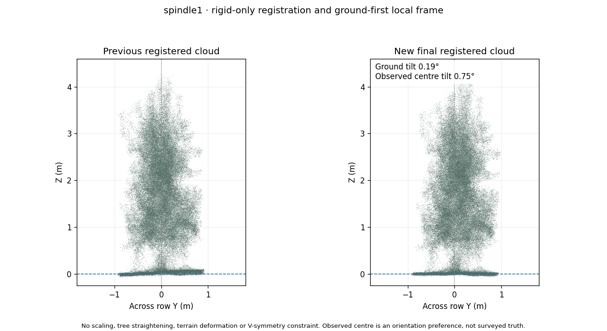
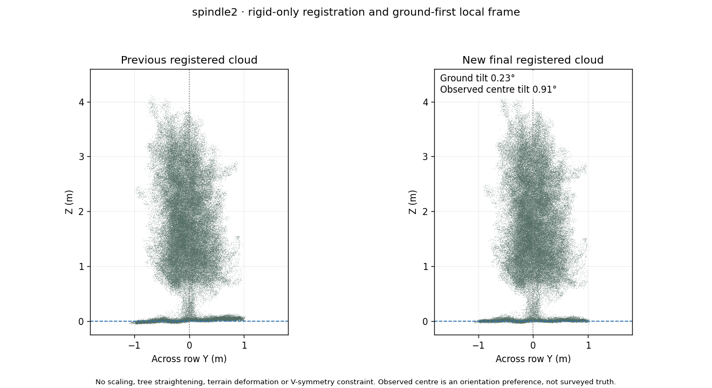
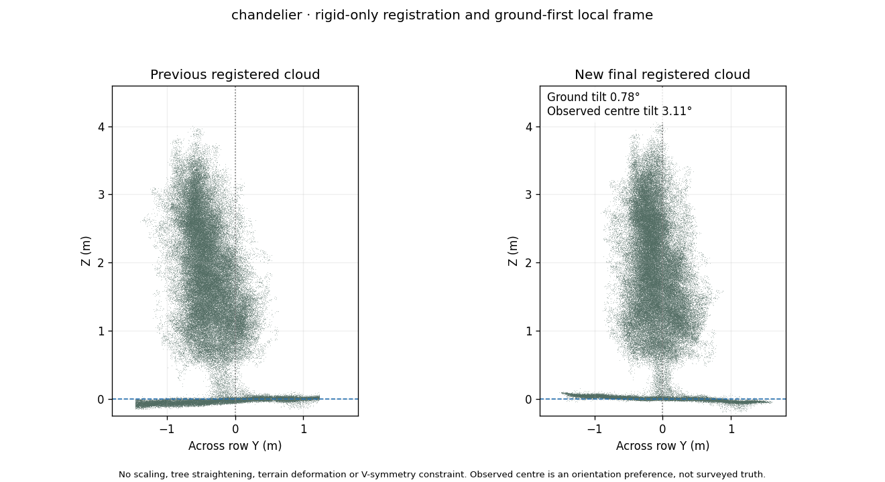
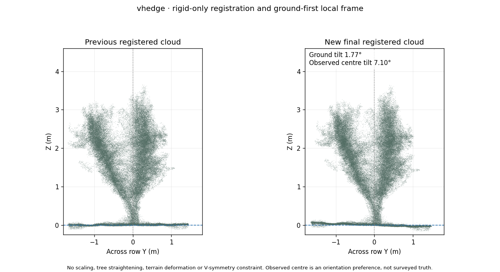

# Current final registration and ground-first local frame

The user requested new complete registered point clouds for every growing system, with the ground as level as practical and the central treeline roughly upward. This changes the final outputs. Earlier raw-angle and narrow-ground experiments remain historical diagnostics.

| Dataset | Measured points | Ground tilt | Observed centre tilt | New relative scan refinement |
| --- | ---: | ---: | ---: | --- |
| spindle1 | 1,227,174 | 0.19° | 0.75° | Existing relative poses retained |
| spindle2 | 1,282,862 | 0.23° | 0.91° | Accepted |
| chandelier | 1,527,905 | 0.78° | 3.11° | Accepted |
| vhedge | 830,803 | 1.77° | 7.10° | Existing relative poses retained |









## What we learned and changed

The narrow under-trunk fit changes the ground reference, but its strip-width sensitivity makes it unsuitable as a universal orientation answer. Ground points alone cannot establish full-height tree alignment. The previously withdrawn 82.3° proxy did not identify a biological V centre. Occluded point averages and canopy PCA are not independently calibrated vertical references. None of those claims is reinstated here.

The new process separates **relative scan registration** from **one common output-frame choice** per dataset. Every recording has one proper rigid pose. Ground and tree points are never rescaled, sheared, made symmetric, independently flattened or straightened. A final shared frame cannot change the actual angle between a tree and its ground.

## Relative registration

All scans on both sides are re-evaluated together from the accepted working-frame geometry. The joint model uses freely leaning low-trunk axes with representative size ranges, symmetric point-to-plane distances between local measured terrain patches, and same-facing woody surface overlap. It does not fit one V arm onto the opposite arm or constrain either arm upright. Spatial/height validation returns are excluded from training. Renewed correspondences charge a capped cost to unmatched returns, and alternative coordinate anchors are checked.

The existing acceptance checks are unchanged. Spindle 2 improves excluded low-trunk cylinder RMS from **20.77 to 18.09 mm**; Chandelier improves from **15.44 to 12.85 mm**. Both pass terrain, same-side/cross-side overlap and anchor checks. Spindle 1 improves only about 4%, below the existing 10% threshold, so its accepted relative scan poses are retained. A further V-hedge iteration improves about 7%, also below that threshold; the previously repaired joint geometry is retained. Rejected candidates and reasons are included in QC rather than silently promoted.

These are conditional internal residuals against representative-size cylinder models, not independently surveyed tree-diameter or registration accuracy.

## Ground-first frame

The ground reference uses measured returns near the existing soil level in three row-centred strips with half-widths 0.35, 0.50 and 0.70 m. A measured lower-quartile return from each 12 cm XY cell reduces density/grass weighting; robust free-slope fits are combined through their median coefficients. Grass and root flare can still bias this reference. All original returns are retained in the final cloud; only the reference estimation is sampled.

The weak upward preference uses height-binned midpoints between 10th and 90th across-row quantiles in several tree windows of the **combined cloud**, with spatial sampling and equal window weighting. This does not deliberately select a visible V arm or average independent raw origins. It is still an **observed-envelope convention**, not a verified biological central plane. It can be biased by actual asymmetry or occlusion, so it only chooses the common coordinate frame and never changes relative scan poses.

The shared up vector is the normalized weighted sum `4 * ground_normal + observed_centre_axis`. A proper rotation maps it to output Z; a yaw aligns the row with X. Translation sets a low-row ground reference near the first trunk to the origin. The 4:1 weights explicitly prioritize level ground while allowing a modest upward-centre preference. The chosen frame differs from IMU/Earth vertical; the original IMU-up direction expressed in output coordinates is stored in the report.

V-hedge remains the limiting case: its ground normal is about **1.77°** from output Z and its observed centre direction about **7.10°** from output Z. This is a compromise, not a claim that its orientation problem is solved. Forcing both references to their targets would require changing the measured geometry or adding stronger physical assumptions. No such deformation or assumption is hidden in this result.

## Outputs, source identity and mesh

The same Current release and five assets are used. `01_final_aligned_pointclouds.zip` contains all four new PLYs; `03_transformations.zip` contains matching original-sensor-to-final and gravity-levelled-to-final matrices. Separate and recording-coloured contributions use the same final poses in `91_registered_contributions.zip`. Intensity/SIGNAL, NIR, reflectivity, derived leaf/wood RGB, source IDs, point order and retained point counts are preserved. Final matrices are already applied to PLY coordinates.

Chandelier's mesh is independently rebuilt from the exact new PLY using the existing point-cloud-only mesher and parameters. Its canopy is watertight with **607,432 triangles**; the optional combined scene includes an open ground sheet. The mesh source hash must match the new PLY. Other datasets remain point clouds; no extra meshes were requested or generated.

Previous accepted working-frame XYZ, matrices and existing mesh are archived inside `90_QC.zip` at `QC/<dataset>/provenance/balanced_registration_baseline.zip`. New reports, composed corrections and before/after figures are at `QC/<dataset>/balanced_registration/`. Earlier QC figures describe earlier working frames. Rebuilds restore the archived working frame before upstream algorithms run, preventing double application of the final corrections.

- [Spindle 1 before/after](QC/balanced_registration/spindle1_before_after.png)
- [Spindle 2 before/after](QC/balanced_registration/spindle2_before_after.png)
- [Chandelier before/after](QC/balanced_registration/chandelier_before_after.png)
- [V-hedge before/after](QC/balanced_registration/vhedge_before_after.png)
- [Summary and independent export checks](../results/balanced_registration_summary.json)

```bash
python tools/refine_balanced_collection.py --stage /path/to/current_collection
```

The full publisher restores these working frames before running preceding registration stages, then applies this final stage before packaging. Meshing can still be run independently through `run_meshing.py` with only a point cloud. Tests cover proper rigid transforms, asymmetric shape and terrain preservation, raw/RGB attribute retention, composed sensor-pose reconstruction, and exact repeat export after baseline restoration.
