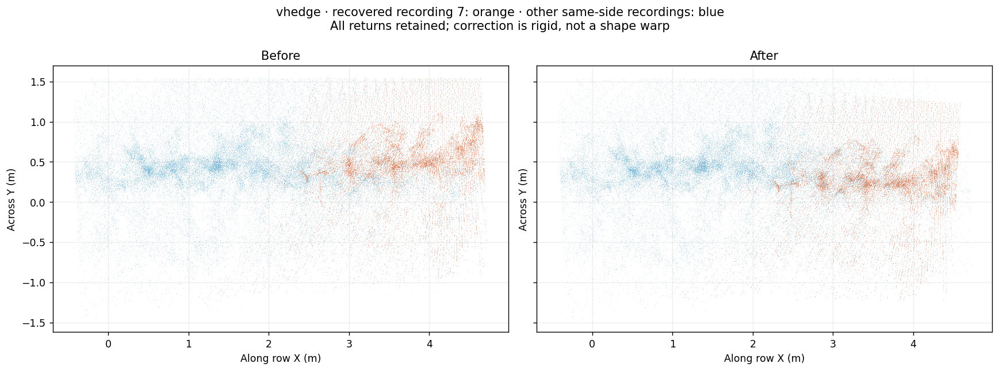
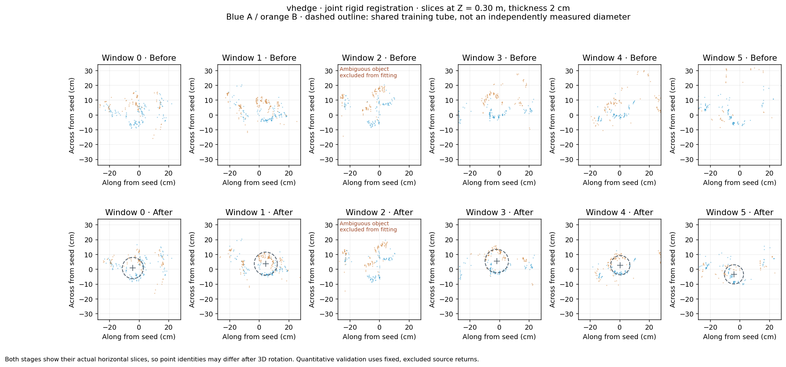
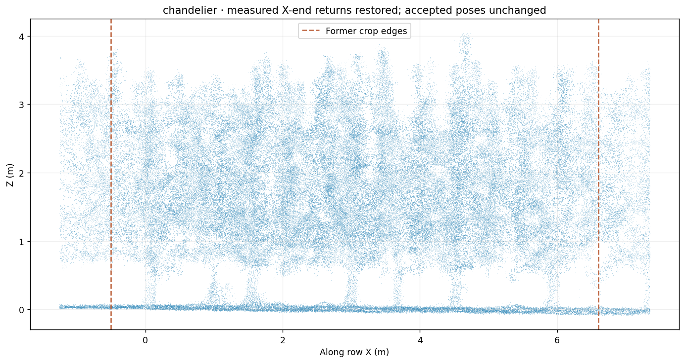

# Current joint registration and measured ROI extension

**V-hedge now uses the joint rigid result. Chandelier has a wider measured X ROI and a matching rebuilt mesh. The accepted spindle outputs remain unchanged.** All results stay in the single [Current release](https://github.com/u0063882/GreensprayAI/releases/tag/current), under the existing dataset folders and five download names.

The implementation does not make a V symmetric, make a support bar horizontal, make trunks vertical, flatten the soil, scale a cloud or warp individual points. It estimates one rigid transformation per recording from measured overlap, local terrain, low-trunk geometry and a weighted gravity constraint. Registration and meshing remain separate.

## What was actually wrong

The first V-hedge B recording, `sideB_084742` (scan ID 7), had **no accepted within-side registration edge** and no usable low-trunk observations in the former refinement. It was nevertheless present in the merged output near its rough initial pose. A broader same-side search finds a stable rigid correction near **6° yaw and 29 cm position change** before the smaller joint adjustment. Thirty of 45 starting poses converge to the same recovery mode.

Excluded-return checks for that recovery improve coverage within 8 cm from approximately **17% to 67%**, and median distance to the other side-B surfaces from **16.5 to 5.9 cm**. These values use excluded source and target returns; the sparse spatial partitions and occlusion limit the absolute distances. They are internal consistency measurements, not surveyed accuracy.



Orange is the recovered recording, blue its same-side peers. No measurement is deleted or scaled.

A second confirmed weakness was the former ground-cell residual: median Z values from different XY locations within the same 15 cm cell were treated as though they should agree. On the plane `z = 0.12*x - 0.08*y + 0.03`, two perfectly aligned observations within one cell can differ in Z by 6 mm. The new symmetric point-to-plane residual correctly gives zero for that example. The terrain planes retain their measured slopes.

## Joint fit and validation

The existing assembly is an initial estimate. Both sides then receive adjustable per-recording rotation and translation. Only a coordinate-origin/yaw gauge is constrained at one recording; its roll/pitch and the other recordings remain adjustable. Shared low-trunk axes, radii and taper are fitted jointly with the poses. Axes are free to lean. Representative workbook circumferences help identify plausible trunks; they are not mapped to individual trees as exact ground truth.

Training uses low-return bands 15–24 and 36–45 cm in the existing local Z datum. The 26–34 cm band is excluded. Ground training/validation use disjoint original source cells and separate local-plane estimates. Higher structures contribute only close, reciprocal, same-facing provisional-wood matches; opposing bark hemispheres are not matched as coincident surfaces. Excluded higher-return sets are evaluated separately.

One V-hedge window, ID 2, drives the shared cylinder to its radius/taper limits. It is **excluded from fitting based on training geometry**, not forced into a trunk interpretation. Its original measured points remain in every output and in the figures. This is remaining object-association uncertainty, not a missing exported tree.

| V-hedge check | Before | Joint result |
| --- | ---: | ---: |
| Excluded low-stem median absolute radial residual | approximately 15.8 mm | approximately 10.1 mm |
| Excluded low-stem radial RMS | approximately 33.8 mm | approximately 16.4 mm |
| Excluded terrain median absolute residual | 7.72 mm | approximately 7.71 mm |
| Relative reconstruction change with different coordinate gauges | — | approximately 0.2 mm RMS |

The baseline and candidate each get their own models fitted from training returns. Validation uses identical excluded source-return identities. Terrain validation evaluates a local measured plane at the actual query XY; unmatched ground queries receive a fixed cost cap. Higher-structure validation re-matches the same excluded source/target sets after pose changes, reports coverage, and charges unmatched queries the distance cap.

Re-matching matters: after a substantial pose repair, old nearest-neighbour identities can be wrong. In this case retaining those old identities would misleadingly penalise a recovery that strongly improves actual overlap. The earlier fixed-pair diagnostic is preserved as historical QC, not treated as independent correspondence truth.



The dashed outline is the shared training tube, not an independently measured diameter. Each panel shows an actual 2 cm horizontal slice at Z = 0.30 m, so the displayed source points can differ after 3D rotation. Quantitative validation retains fixed excluded return identities. Heights refer to the local row datum; they are not an independent per-tree ground survey.

The two alternate coordinate gauges are on scans 7 and 12. After removing only a common rigid frame difference, their reconstructed geometry differs by roughly 0.2 mm RMS. This tests dependence on the chosen reference; it does not claim submillimetre measurement accuracy.

The same model was run on all four datasets:

| Dataset | Joint checks | Current output policy |
| --- | --- | --- |
| V-hedge | Pass | Joint poses applied, including recovered scan |
| Spindle 1 | Insufficient additional improvement | Accepted trunk-refined result retained |
| Spindle 2 | Pass | Accepted trunk-refined result retained; comparison in QC |
| Chandelier | Pass | Accepted poses retained; measured ROI extension and matching mesh applied |

All candidate comparisons and uncertainty remain in QC. Dataset selection is in `presets/joint_registration.json`; the mathematical model has no V-specific branch-angle or symmetry rule. A small repeatable sensor-frame gravity discrepancy was investigated across datasets, but no inferred accelerometer-bias calibration is applied to these outputs.

## Chandelier cutoff and matching mesh

The original X crop **−0.5…6.6 m** is extended to **−1.25…7.35 m**, retaining the same narrow row strip and height limits. Original PCAP returns are decoded through the **unchanged accepted poses**. The final cloud grows from **1,219,008 to 1,326,879 points**: **107,871 additional measured samples**. Every former primary-cloud sample is retained as an exact prefix, and every former per-recording sample is retained. Newly added samples keep raw SIGNAL/intensity, ambient NIR, reflectivity, source frame/pixel IDs and the saved shared leaf/wood mapping.



The dashed lines show the former crop. The wider bounds are explicit in `presets/roi_extensions.json`; the extension does not invent returns or recover areas absent from the recordings. Neighbouring canopy can overlap the selected row ends.

The independent voxel/SDF mesher reads the expanded PLY and a ground surface inferred from that PLY. It receives no registration state. The rebuilt closed envelope has approximately **263,634 vertices / 527,228 triangles** and passes closed-edge, vertex-manifold and orientability checks. Its report hashes the exact final expanded PLY. The combined scene includes a separate open ground sheet. This is the existing shrinkwrap-style approximation, not native Rhino ShrinkWrap; a full global triangle self-intersection search is not performed.

## Files, preservation and reruns

- `01_final_aligned_pointclouds.zip`: current dataset PLYs; already registered.
- `02_final_mesh.zip`: rebuilt chandelier envelope/ground; the other datasets have no mesh yet.
- `03_transformations.zip`: matrices matching each final cloud and its contributions.
- `91_registered_contributions.zip`: separate scans and a combined recording-colour view, with `scan_id`, original channels and leaf/wood RGB.
- `90_QC.zip`: `QC/<dataset>/joint_registration/`, `QC/chandelier/roi_extension/` and original-result archives under provenance.

The V-hedge primary contains the same **830,803 source samples**, in the same order, with every non-coordinate field unchanged. The new 3D rigid fit can change Z; RGB, classification, intensity and source IDs are preserved. The legacy height-band classification field is not leaf/wood truth.

`QC/vhedge/provenance/joint_registration_baseline.zip` prevents applying corrections twice on reruns. `QC/chandelier/provenance/roi_extension_baseline.zip` preserves the complete former cloud, contributions, matrices and mesh. ROI reruns reconstruct from that original crop and retain current colour attributes. The earlier trunk-stage caches are updated only after verified authorised exports.

For an unpacked collection arranged as `pointclouds/`, `transformations/`, `contributions/`, `meshes/` and `QC/`:

```bash
python tools/refine_joint_collection.py --stage /path/to/collection
python -m unittest discover -s tests -v
```

The release workflow orchestrates original-input ROI recovery, the independent mesh rebuild, joint registration, report generation and server checksum verification. `git pull` updates code/docs; download fresh release ZIPs to get the data.

Synthetic and export tests cover sloping ground, genuinely leaning/asymmetric geometry, known rigid pose recovery, coordinate-gauge changes, disconnected graph nodes, measurement/RGB preservation, matrix composition and rebuilds without double application. **56 tests passed locally.** Full machine-readable outcomes are in QC and [the repository summary](../results/joint_registration_summary.json).

These checks support improved internal registration consistency. They do not independently establish every upper branch position or guarantee biological symmetry. The remaining ambiguous window is explicitly shown rather than corrected to a template.
