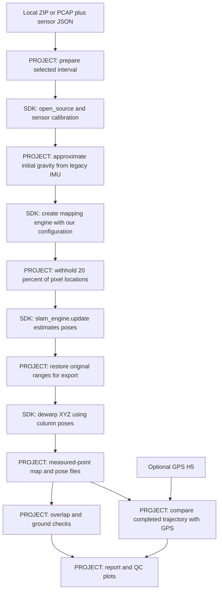

# Moving registration: workflow, SDK boundaries and GPS

Start with [`run()` in dynamic/pilot.py](../dynamic/pilot.py). Its numbered
sections follow the processing order. Comments marked **[SDK]** identify
Ouster calls; **[PROJECT]** identifies decisions made by our Python code.
The main file is formatted with one statement per line and descriptive names
such as `column_poses`, `valid_returns` and `trajectory_positions`.

**GPS does not currently restrict or correct SLAM.** It is a diagnostic
comparison made after the SDK has estimated the trajectory. Neither
`--gps-clock shared-start` nor `--gps /path/to/file.h5` turns on GPS factors,
position bounds, GPS heading initialization or georeferencing.

This page describes the moving pipeline invoked by `run_moving.py`. It is
separate from the stationary orchard registration and from meshing/GIF tools.

## File map

| File | Responsibility |
| --- | --- |
| [`run_moving.py`](../run_moving.py) | Thin local command entry point |
| [`dynamic/offline.py`](../dynamic/offline.py) | Parse options, stage input, call `pilot.run()` |
| [`dynamic/prepare.py`](../dynamic/prepare.py) | Copy the selected capture-time interval and matching sensor JSON/GPS H5 |
| [`dynamic/pilot.py`](../dynamic/pilot.py) | SDK configuration/update loop, point export and QC |
| [`captures/leafwood.py`](../captures/leafwood.py) | Raw-channel handling and provisional leaf/wood display classification |
| [`tools/export_rhino.py`](../tools/export_rhino.py) | Optional CAD compatibility copies; no pose fitting |
| [`dynamic/animate.py`](../dynamic/animate.py) | Independent GIF rendering from already registered output |

## General workflow



The SDK update/dewarp steps repeat for each accepted scan. There is **no arrow
from the GPS check back to the SDK**: the current program has no such feedback.

## What Ouster supplies, and what we do

| Stage | Ouster SDK supplies | Our code supplies |
| --- | --- | --- |
| Input preparation | Nothing in the packet-trimming step | Preserve classic-PCAP headers/payloads inside the selected time interval; copy metadata |
| Decoding | `open_source`, `PcapPacketSource`, `PacketFormat`, scan fields and sensor calibration | Single-sensor selection, completeness threshold, packet audit |
| Initial orientation | Decoded legacy acceleration and extrinsic matrices | First-second median acceleration; one initial body-to-map rotation |
| SLAM setup | `mapping.SlamConfig.create("lio")` and `mapping.SlamEngine.create(...)` | Deskew mode, ranges, voxel size, iteration limit, initial pose |
| Pose estimation | **`slam_engine.update(frame_set)`** and resulting `scan.body_to_world` matrices | Withhold test pixels, restore ranges, check obvious pose jumps |
| Point placement | `core.XYZLut(sensor_info, True)` and `core.dewarp(...)` | Select measured first returns; retain channels/IDs and sample the output |
| Scan archive | `osf.Writer` | Choose accepted scans and output paths |
| GPS/QC/export | No GPS integration is called here | H5 interpolation, rigid comparison, overlap checks, ground diagnostics, PLY/JSON/CSV/NPZ/Rhino exports |

The underlying registration optimizer is inside the installed Ouster SDK.
This Python file does not implement its ICP residuals/correspondence search.
Its nearest-neighbor `cKDTree` calls are **our validation checks**, not the SDK
SLAM optimizer. The ground-plane RANSAC call comes from **Open3D**, not Ouster.

## Walk through `run()`

### 1. Prepared input and approximate gravity

`dynamic.prepare` selects the first requested number of **capture seconds**
(15 by default), or the complete input when `--all` is explicitly supplied.
It keeps all packet types, including IMU. It does not decode trees or GPS.
The input files remain unchanged.

`packet_audit()` uses SDK packet decoding, then our code takes median
acceleration over the first capture second. Sensor metadata rotations bring
the acceleration into the body frame. `gravity_pose()` creates a common initial
map frame whose +Z follows approximate up. Yaw is chosen from projected body
+X; it is not GPS-derived heading.

Vehicle acceleration can bias this initial vertical. We do not force the ground
horizontal or trunks upright. Gyroscope values are summarized but not integrated
by our Python code.

### 2. SDK configuration

```python
slam_config = mapping.SlamConfig.create("lio")
slam_config.deskew_method = "constant_velocity"
slam_config.voxel_size = voxel          # default 0.15 m
slam_config.min_range = 1.0             # m
slam_config.max_range = max_range       # default 25 m
slam_config.max_iterations = 50
slam_config.initial_pose = initial_pose # our approximate gravity orientation
slam_engine = mapping.SlamEngine.create([sensor_info], slam_config)
```

`"lio"` is the SDK engine name. The explicit constant-velocity deskew setting
used for this legacy-IMU recording is not a claim of fully coupled inertial
navigation. No GPS coordinates, leaf/wood labels, ground plane or tree model
is supplied in this configuration or in the update call.

### 3. The scan loop: SDK fits poses; our code prepares/checks/exports

1. Check completeness against the configured active column window. Require
   at least 98% coverage; do not mistake a configured 180-degree view for an
   incomplete 360-degree scan.
2. Decode organized body-frame XYZ with the SDK lookup table. Keep the
   original row/column indexing; do not destagger before applying column poses.
3. Temporarily zero both range returns at 20% of pixel locations. Those held-out
   returns are excluded from fitting and used later for a consistency check.
4. **Call `slam_engine.update(frame_set)`.** This is where the SDK estimates
   motion and attaches per-column transforms to the scan.
5. Restore original ranges, including held-out pixels, before saving scans and
   attributes. Read `scan.body_to_world` into `column_poses`.
6. Stop the loop if a pose is nonfinite or a consecutive accepted-frame step
   exceeds 1 m or 25 degrees. This guard does not repair the pose: it leaves a
   flagged, potentially partial result containing earlier accepted scans.
7. Apply the SDK column transforms with `core.dewarp`. Save the posed OSF scan.
8. Keep selected measured first returns with their original signal, NIR,
   reflectivity, frame/pixel IDs and derived RGB. Compute display classes
   **after** SDK fitting; this moving pipeline does not use coloured ICP.
9. Store a small set of held-out points for before/after overlap checking.

### 4. Fuse measurements and save poses

There are three different spatial settings:

| Setting | Purpose | Default |
| --- | --- | --- |
| SDK internal voxel | Mapping/registration configuration | 0.15 m |
| Per-scan output sampling | Retain actual measured returns with paired attributes | 0.04 m |
| Final map output sampling | Retain actual measured returns across accepted scans | 0.025 m |

These are not accuracy estimates. Export sampling picks a real measurement;
it does not average points into invented centroids or deform the trees.

### 5. QC after mapping

- `navigation()`: GPS comparison described below.
- `consistency()`: held-out nearest-neighbor overlap for scan pairs five accepted
  scans apart, with distances capped at 10 cm. This is an internal comparison
  affected by density/occlusion, not surveyed registration accuracy.
- `ground_check()`: Open3D RANSAC on the lower 30% of a sampled map, then
  time-group residuals. This diagnostic never levels or changes the map.

The two post-hoc report flags are: a GPS/SLAM traveled-distance ratio outside
0.5–2 when GPS endpoint displacement exceeds 1 m, and held-out capped RMS more
than 5% worse than the unregistered baseline. Timestamp ordering is checked too.
These checks change **report status only**. They do not send corrections back
to the SDK, remove points, re-fit poses, or reject the already exported cloud.
Their thresholds are coarse screening choices, not confidence bounds on position.

### 6. Reports and compatibility copies

The completed local map and per-column poses have already been saved before
the GPS check. CSV/JSON expose centre-pose summaries. Optional Rhino copies
change file representation/units, not geometry. GIF rendering, its brightness
controls and optional normal shading never feed back into registration.

## Three clocks, and what `--gps-clock` means

| Clock | Use |
| --- | --- |
| Lidar column timestamps, integer ns | Per-column timing; relative point times and saved exact timestamps |
| PCAP packet capture timestamps, seconds | Select the input interval and place frames on the capture clock |
| H5 `time` array, seconds | Interpolate GPS antenna positions for a diagnostic comparison |

Some historical report/CSV keys contain `unix`, but the PCAP clock can be
relative. Those names do not convert it to calendar time.

`--gps-clock absolute` compares the capture timestamps directly with H5 times.
If the time ranges do not overlap, no GPS track comparison is produced.

`--gps-clock shared-start` applies the software-start assumption you supplied:

```python
query_gps_time = first_valid_gps_time + (
    frame_capture_time - first_pcap_packet_time
)
```

GPS latitude/longitude are interpolated at these query times. Thus **614 scans
and 573 GPS samples** are compatible: there is no requirement for equal sample
counts, and sample 10 is not simply paired with GPS sample 10. There is no
time stretching to force end times to agree. Shared software start remains an
assumption with possible startup latency, not hardware synchronization proof.

The GPS points become local east/north coordinates. A copy of SLAM XY is fitted
to them with horizontal rotation and translation, **without scale**. This removes
the arbitrary local heading/origin for comparison while leaving drift visible.
Absolute GPS coordinates are omitted from derived reports. The unknown
antenna-to-body offset is not calibrated or corrected.

**That rigid comparison is not applied to `registered.ply`, the pose files,
or the SDK map. The outputs remain in the local SLAM frame.**

## Pose convention and source provenance

SDK geometry follows:

```python
body_xyz = xyz_lookup(scan)                  # calibrated sensor -> body, metres
column_poses = np.asarray(scan.body_to_world) # one 4 x 4 matrix per column
map_xyz = core.dewarp(body_xyz, column_poses)

# Column-vector convention for a return from column c:
map_point = column_poses[c] @ [body_x, body_y, body_z, 1]
```

`per_column_poses.npz` retains those full matrices, column status and integer
lidar timestamps. `trajectory.csv` and `transformations.json` use a valid
centre-column pose per scan for convenience. Use the per-column arrays to
reproduce deskewed points; a single frame-centre transform cannot exactly
reproduce a moving scan. Do not apply any transform again to the registered PLY.

`scan_id` is the accepted moving-scan index; `frame_id` is the original sensor
frame ID; `pixel_index` is the organized row-major source index. These keep
selected points connected to their original sensor attributes.

## If GPS constraints are added later

A separate trajectory refinement would need time alignment, measurement
uncertainty, and the antenna lever arm in the body frame. Its prediction would
include the rotating offset, for example:

```python
antenna_map = body_position_map + body_rotation_map @ antenna_offset_body
antenna_ENU = map_to_ENU_rotation @ antenna_map + map_to_ENU_translation
gps_residual = antenna_ENU - measured_antenna_ENU
```

Those weighted GPS residuals could be combined with relative-motion constraints
in a pose-graph optimization. They would then influence the trajectory and
require reapplying corrected per-column poses to the original measurements.
**This stage is not implemented in the current moving program.** It should not
be confused with the present post-hoc rigid overlay or GPS warning flag.
