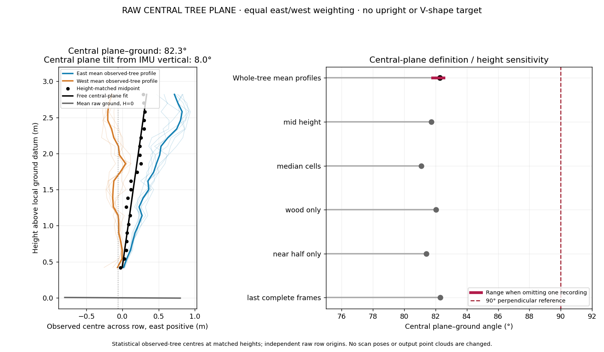
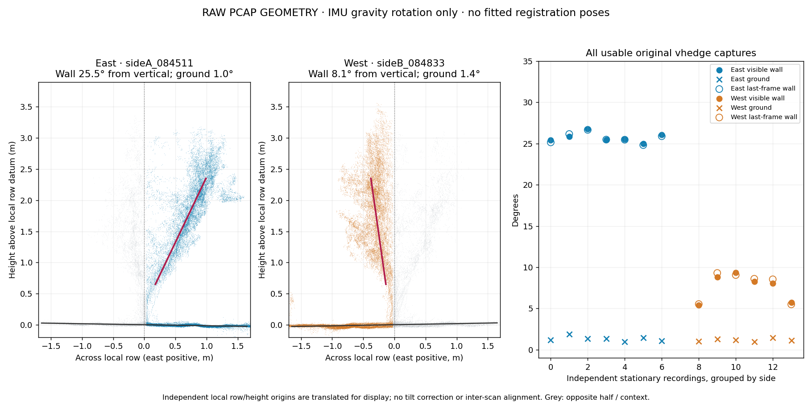
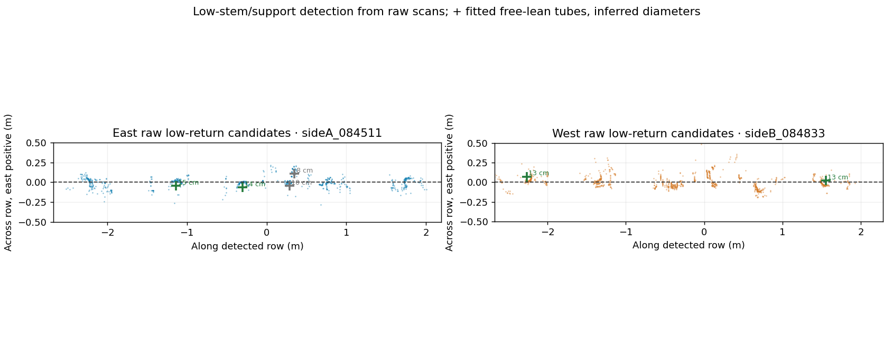
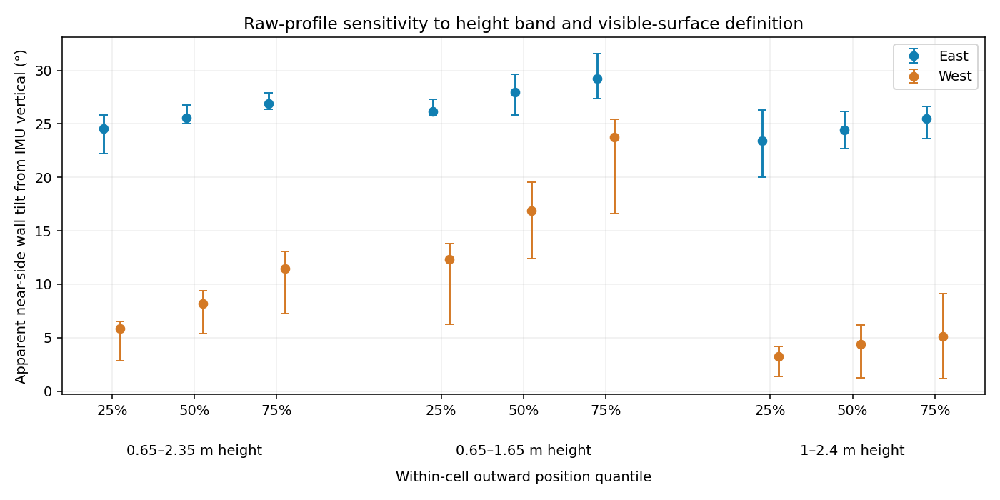

# Original captures: central tree plane versus ground

**The requested measurement is the average/central tree plane against the ground, not either arm of a V against vertical.** The V arms may naturally incline; the same estimator must also work for other growing shapes.

For the original V-hedge captures, using IMU rotation only:

| Central-plane measurement | Raw-data estimate |
| --- | ---: |
| **Central observed-tree plane to detected ground** | **approximately 82.3°** |
| Departure from perpendicular to ground | approximately 7.7° |
| Central-plane lean from IMU vertical | approximately 8.0° eastward |
| Balanced mean raw ground-normal tilt from horizontal | approximately 0.4° |
| Common observed heights used | 0.42–2.82 m |
| Recordings | 7 east, 6 west |

The earlier **25.5° / 8.2°** figures describe individual visible side-wall profiles. They are supporting diagnostics below, **not** the central-plane/ground angle.



The black dots are midpoint averages at matched heights; the black line is a free central-plane fit. Blue and orange curves are the independently observed tree-centre profiles contributing from each track. Their positions use separate raw row origins, so the intercept is arbitrary; the inclination is the quantity measured. Grey is the equally weighted mean raw ground plane in the same row/up basis. No cloud is rotated to make the central plane upright.

## Central-plane estimator

The raw decoding, IMU and ground/low-stem detection protocol is described below. After that, the central estimator:

1. Uses **all selected tree returns**, including both visible halves, 0.3–3.0 m above the local row/ground datum. It does not select an individual V arm. Context outside the detected row section and ±1.7 m across it is excluded.
2. Balances occupied 25 mm voxels, then 45 cm along-row × 12 cm height cells. Each cell contributes a mean across-row position. A freely fitted along-row trend evaluates profiles at a common along-row location; there is no upright or symmetry prior.
3. Interpolates each recording's centre profile only within its measured height coverage. The common supported grid is 0.42–2.82 m; no endpoint is extrapolated.
4. Averages recordings **within each track**, then gives east and west **equal weight at every height**. Seven recordings on one track therefore do not outweigh six on the other. In a common east-positive across-row basis, `central(z) = (meanEast(z) + meanWest(z))/2`.
5. Fits a central plane with free inclination and intercept through those height-matched centres. Curved, V-shaped, spindle or chandelier profiles are not prescribed. Constant independent horizontal origins affect the intercept, not the inclination.
6. Expresses the independently detected raw ground normals in the common horizontal-row/IMU-up basis, balances the tracks in the same way, and measures the central-plane/ground dihedral. No registered sensor pose, cross-side ICP or PCA-up transformation is read.

The mean-ground tilt differs from the individual scan tilt magnitudes below: normals are expressed in a common row/up basis before averaging, so opposing components can partly cancel. This is not a new ground-levelling operation. Absolute cross-side central-plane position is not inferred; only inclination is measured.

This is the **statistical central plane of the observed points**, not an independently surveyed trunk or biological symmetry plane. Occlusion and different foliage/support visibility can bias observed centres. The raw estimate establishes a lean in the balanced visible data before registration; it does not prove that the true architecture of every tree is tilted by exactly 8°.

## Central-plane repeatability and definition checks

| Central estimator variant | Central plane–ground angle |
| --- | ---: |
| All-return mean-cell profiles, primary | 82.3° |
| Mid-height 0.65–2.35 m input band | 81.7° |
| Median instead of mean cell centres | 81.1° |
| Provisional wood-only centres | 82.0° |
| Near-facing halves only | 81.4° |
| Last complete frames instead of first | 82.3° |

Omitting each original recording in turn gives approximately **81.8–82.5°**. First- versus last-frame central estimates differ by approximately **0.02°**. These are internal repeatability/sensitivity results, not survey confidence intervals or absolute orientation accuracy.

Synthetic tests use different curved growing profiles around the same genuinely leaning centre, and recover that centre without a shape template. They also test track balance, independent horizontal origins and absence of height extrapolation.

[Central-plane angles as CSV](../results/vhedge_raw_central_plane.csv) and the [full public evidence](../results/raw_geometry_audit.json) are available. In the existing release, `90_QC.zip → QC/vhedge/raw_geometry/raw_central_plane.png` and `central_plane_angles.csv` are the primary raw checks. All current point-cloud, contribution, transformation and mesh files remain unchanged.

## Supporting individual-wall diagnostics

**The visible side-wall asymmetry is already present in the original, IMU-levelled PCAP measurements. Later registration did not create this observed profile difference.** This audit reads no registered cloud or fitted scan pose and applies no PCA-up correction. Current point clouds, matrices and mesh are unchanged.

| Raw-source measurement | East track, 7 recordings | West track, 6 recordings |
| --- | ---: | ---: |
| Visible near-side wall/profile tilt from IMU vertical | approximately **25.5°** | approximately **8.2°** |
| Scan-to-scan range of that profile estimate | approximately 25.0–26.8° | approximately 5.4–9.4° |
| Detected ground-plane tilt from horizontal | approximately **1.3°** | approximately **1.2°** |
| Angle between the visible wall plane and its own ground plane | approximately **65.6°** | approximately **82.4°** |

Values are medians across the usable stationary recordings. They describe fitted **visible vegetation sheets**, not verified individual branch axes. The ground retains its measured slope.



Each example uses a separate original lidar frame. The examples are the scans closest to each side's median profile estimate. For display only, each scan's detected row/ground origin is translated to zero and the horizontal row direction defines the cross-section. Z remains IMU vertical; there is no inter-scan registration or rotation that makes the ground horizontal. Grey shows opposite-half/context returns. Red is the fitted near-side profile, not an imposed target.

## What the supporting side-wall measurements establish

A rigid transformation rotates a tree-wall normal and its ground normal together. It preserves the angle between them. The east/west difference in the last table row therefore cannot be created or removed by a rigid stitching operation on those same measured features.

The approximate difference between the two outward profile inclinations is **17.4°**. The sum, approximately **33.7°**, is the apparent opening of the independently fitted median sheets; it is not a matched individual-tree V opening. Rotating the entire scene by roughly half the inclination difference to make these two profiles look symmetric would also rotate the measured soil by roughly 8.7°. That would not be justified by the slight ground slopes seen here.

This does not prove that every biological branch has an asymmetric angle. Occlusion, support posts, foliage and crown curvature affect which physical structures dominate each view. IMU/factory calibration uncertainty also remains. The result establishes that the **observed profile difference predates registration**, rather than proving an exact biological branch angle or perfect registration everywhere.

The earlier repair of disconnected recording `sideB_084742` remains valid and is not reversed by this audit. The remaining profile difference appears in every usable recording, including the other west-side views; it is not explained by that single rough-pose contribution.

## Raw-source protocol

1. Read the original PCAP plus its matching factory JSON and H5 RTK data. Determine east/west from median RTK longitude: **sideA is east and sideB west for V-hedge**, with about 4.25 m median easting separation. A/B are not assumed to mean the same geographic side in other datasets. GPS is used here to name the tracks, not to register clouds. Absolute RTK coordinates are omitted from the published audit reports.
2. Read stationary IMU acceleration packets, apply the factory IMU-to-sensor rotation and use their median to establish gravity. No inferred accelerometer bias or registration-derived gravity correction is applied.
3. Decode factory `XYZLut` **first returns** in the 0.5–12 m range. Choose the earliest frame with maximal packet-column completeness. All 13 selected frames have the full configured **513 valid columns**. The old sensor-forward 3.15 m gate and final-output ROI are not used.
4. Retain measured samples in 15 mm cells, with no centroid replacement. These samples receive only the IMU rotation. Detect the ground plane robustly, retaining its freely fitted normal and slope.
5. Detect low-stem/support candidates 13–47 cm above the provisional local terrain and fit their horizontal row direction. Re-estimate ground directly under that row. Candidate cylinder axes, radii and taper are free; trunks are not made upright. Ambiguous clusters remain unclassified.
6. In the near-facing half, balance measured returns in 25 mm voxels, then use median outward positions in 45 cm along-row × 12 cm height cells. Fit a free sheet over the same **0.65–2.35 m** height band on both sides. For local along coordinate `h`, outward coordinate `u` and IMU-up height `z`, the model is `u = b_h*h + b_z*z + b_0`. The displayed profile inclination is `atan(b_z)`; the full plane normal and plane/ground dihedral are also saved.

These supporting wall fits use **all returns**, without a green/brown selection. A secondary sensitivity check uses the existing shared intensity/NIR model; it does not determine the primary angle or alter any points.



The size-based labels on fitted low cylinders are provisional. There is no surveyed tree correspondence or assumption that a support is circular, vertical, or the same object as a neighbouring trunk. Each raw recording is analysed independently.

Two supplied inputs are excluded explicitly: the A-folder copy of `084742` is byte-identical to the B recording and belongs to the west track; B `084751` has only one lidar packet and no IMU packets. The complete exclusion reasons and original-source checksums are retained in the machine-readable report.

## Repeatability and sensitivity

Repeating the analysis on the **last** maximally complete frame of each PCAP changes the wall estimate by a median of approximately **0.2°**, with a maximum of approximately **0.5°**. This is within-recording repeatability, not an absolute calibration-accuracy estimate.

The west profile changes substantially with height, so a single fitted angle is an approximation:

| Same median-profile definition, different height band | East median | West median |
| --- | ---: | ---: |
| 0.65–2.35 m, supporting wall fit | 25.5° | 8.2° |
| 0.65–1.65 m | 27.9° | 16.9° |
| 1.00–2.40 m | 24.4° | 4.4° |
| 0.65–2.35 m, provisional wood-only sensitivity | 26.6° | 5.9° |

Within-cell 25th/50th/75th outward-position quantiles are also evaluated. The repeated view asymmetry remains visible; these alternatives show why the quoted values should not be called exact main-branch angles.



## Reproduction and saved evidence

```bash
python tools/audit_raw_capture_geometry.py \
  --data-root /path/to/original/vhedge/data \
  --config presets/captures/vhedge.json \
  --dataset vhedge \
  --output /path/to/raw_angle_checks \
  --repeat-last-frame
```

The input directory contains `sideA/` and `sideB/` with original PCAP/JSON/H5 triples. An optional `--wood-model /path/to/leafwood_model.json` adds the secondary wood-only comparison; it is unnecessary for the all-return measurement. No registered PLY or transformation file is an input.

The [public machine-readable evidence](../results/raw_geometry_audit.json) records source hashes, selected frame IDs, packet completeness, IMU rotations, detected ground normals, horizontal row axes, low-cylinder fits, plane coefficients, sensitivity results and repeatability. [Per-recording angles are also available as CSV](../results/vhedge_raw_angles.csv).

The existing `90_QC.zip` gains `QC/vhedge/raw_geometry/`: the full JSON including sampled profile cells, CSV, PDF and PNG figures, every individual raw profile, and low-stem/row detection. Decoded work caches are kept outside the release. No new top-level asset is added.

All **110 current cloud/contribution, transformation, mesh and supporting geometry files** were hashed before and after the real-data audit and are unchanged. **71 tests pass**, including deliberately unequal wall inclinations, a genuinely leaning cylinder, preservation of soil slope and source arrays, geographic side inference, and invariance of the diagnostic inclination to horizontal heading/origin choices.

The appropriate output policy is to retain physical gravity/terrain references and improve genuine overlap where supported. A symmetric appearance is not an admissible replacement for these raw observations.
