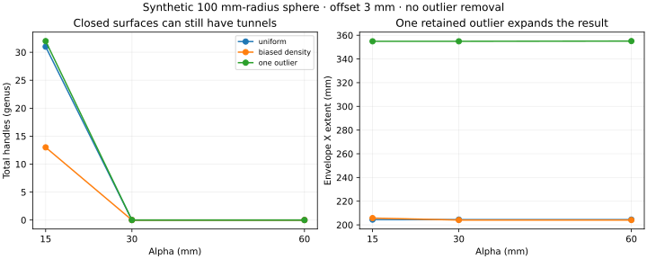

# Controlled shrink-wrapping of orchard point clouds

Research date: 10 November 2026. This document separates documented product behaviour, inspected open implementations, experiments run here, and proposed development. **Recommendation: benchmark CGAL Alpha Wrap as the first tighter point-cloud envelope backend, and OpenVDB for a controllable multiscale volumetric backend.** Neither has yet been validated against the user's Rhino meshes or the full orchard. The existing release remains the voxel/SDF prototype.

Registration and meshing are separate programs. Every backend should consume a point cloud, options and optional generic metadata, regardless of how the cloud was acquired or registered. The current [standalone interface](meshing.md#mesh-a-point-cloud-alone) implements that boundary.

## What Rhino 8 actually exposes

The [Rhino 8 command reference](https://docs.mcneel.com/rhino/8/help/en-us/commands/shrinkwrap.htm) documents approximate target edge length, signed offset, smoothing iterations and adaptive polygon reduction. For point inputs, inflation is enabled by default: inflated neighbourhoods merge when they intersect. Negative offset pulls the result toward the points. Crucially, **“Fill holes in input objects” does not affect point-cloud input**. It is not a point-cloud gap-size control. More smoothing can reduce the enclosed size, and optimization changes edge lengths.

The [official tutorial](https://www.rhino3d.com/docs/guides/modeling/shrinkwrap/) explains the practical coupling: point inflation expands the cloud at a scale associated with target edge length, and a negative offset can compensate. That establishes behaviour, not an exact radius formula. A useful Rhino baseline must record units, Rhino build, input selection, edge length, inflation, offset, smoothing and optimization together. An edge-length value alone does not specify the resulting fit.

The [RhinoCommon API](https://developer.rhino3d.com/api/rhinocommon/type/rhino.geometry.shrinkwrapparameters/) exposes those controls, and [`Mesh.ShrinkWrap`](https://developer.rhino3d.com/api/rhinocommon/rhino.geometry.mesh/shrinkwrap?overload=2) includes point-cloud input. Current API documentation can include features added after Rhino 8; reference tests should pin the installed build.

There is no basis in those documents to assume automatic, locally density-adaptive outlier rejection. An isolated LiDAR return can influence the skin; a sparsely observed genuine branch can resemble an outlier. These require a stated policy, not an assumption that a watertight reconstruction identifies the true object.

The balloon/cloth analogy is useful, but does not establish Rhino's internal numerical solver. McNeel developer discussion of [point inflation](https://discourse.mcneel.com/t/shrinkwrap-challenge/161480) helps explain the visible behaviour. I did **not** verify an authoritative specification of Rhino's complete kernel, source code, voxel rules or convergence method. The OpenVDB method below is an inspected alternative, not a claim about Rhino's implementation.

## Available implementations

| Candidate | What it provides | Assessment for this project |
| --- | --- | --- |
| [CGAL Alpha Wrap](https://doc.cgal.org/latest/Alpha_wrap_3/index.html) | Direct point-set wrapping with geometric validity guarantees | First candidate for a tight envelope; Python binding tested here |
| [OpenVDB](https://github.com/AcademySoftwareFoundation/openvdb) | Sparse fields, particle support and an actual multiscale shrink-wrap implementation for polygon soups | Strong basis for explicit support, gap and resolution controls; needs integration work for raw points |
| [LSWMeshFlow](https://github.com/MCInversion/LSWMeshFlow) | Adaptive remeshing and Lagrangian surface evolution around point clouds/fields | Closest to literally deforming a mesh; research implementation rather than a ready Python service |
| [MeshLib](https://github.com/MeshInspector/MeshLib) | Packaged geometry processing, point-cloud reconstruction and remeshing | Practical candidate, but inspect the specific operator and license rather than equating every “shrinkwrap” function |
| [Rhino.Inside CPython](https://github.com/mcneel/rhino.inside-cpython) | Calls the genuine installed Rhino engine | Best reference backend if a licensed Windows Rhino installation is available |
| [Point2Mesh](https://github.com/ranahanocka/point2mesh) | Mesh deformation using a learned self-prior fitted to an individual input | Interesting research comparator; additional optimization, GPU/dependency and reproducibility work |

### CGAL: a useful first backend

[CGAL's manual](https://doc.cgal.org/latest/Alpha_wrap_3/index.html) describes an outside-in process using a Delaunay tetrahedralization and refinement. Alpha controls accessible detail/cavities, while a positive offset controls separation from the input. Its output is intended to be an oriented, intersection-free, watertight 2-manifold enclosing the input. That is a stronger geometric contract than checking only that all output edges have two incident faces.

This is **Alpha Wrapping, not MATLAB `alphaShape` or a plain alpha-shape boundary**. The [function reference](https://doc.cgal.org/latest/Alpha_wrap_3/group__AW3__free__functions__grp.html) includes point-set input. Larger alpha generally produces a less detailed enclosure; smaller alpha admits finer passages. The resulting triangle size is not an independent target-edge-length control. Remeshing/decimation would be a separate, error-bounded operation.

The [official SWIG bindings](https://github.com/CGAL/cgal-swig-bindings) include [a Python point-set example](https://github.com/CGAL/cgal-swig-bindings/blob/main/examples/python/test_aw3.py). I installed and exercised `cgal==6.0.1.post202410241521` in a separate research environment; that tested wheel is older than the current 6.2.1 manual. No CGAL dependency has been added to the production mesher. Its [package license](https://www.cgal.org/license.html) is GPL/commercial rather than a permissive license; choose the deployment/distribution arrangement deliberately.

A guarantee of enclosing the retained points also explains a limitation: outliers are input geometry, not automatically discarded noise. Nor does validity establish the correct tree shape, the right number of trees, or plausible canopy porosity.

### OpenVDB: explicit support plus multiscale shrinkage

I inspected [`vdb_tool/include/ShrinkWrap.h` at commit c2d96f7](https://github.com/AcademySoftwareFoundation/openvdb/blob/c2d96f735ad88a7d8e0b0a79fdd1292327ba6d36/openvdb_cmd/vdb_tool/include/ShrinkWrap.h). This is an actual coarse-to-fine method, not just a function with a promising name. It constructs offset level-set supports at multiple resolutions, starts with a coarse enclosing result, refines it, and erodes while unioning with the support field. Deformation limits and volume-change checks control evolution. Its entry point takes polygon soups; passing raw points to this interface is not an established point-cloud solution.

For raw point input, OpenVDB separately provides [`ParticlesToLevelSet`](https://github.com/AcademySoftwareFoundation/openvdb/blob/master/openvdb/openvdb/tools/ParticlesToLevelSet.h), including particle spheres and radii. That offers a route to a support field. Combining this with constrained multiscale evolution is a proposed integration, not something tested here. Small particles relative to voxel size need explicit handling, otherwise fine features can disappear before wrapping begins.

The [vdb_tool documentation](https://github.com/AcademySoftwareFoundation/openvdb/blob/master/openvdb_cmd/vdb_tool/README.md) covers field conversion and meshing operations. [NVIDIA's OpenVDB shrink-wrap operation](https://nvidia-omniverse.github.io/usd-optimize/latest/docs/operations/shrinkwrap.html) independently exposes erosion controls for mesh input. Python bindings do not automatically expose every C++ tool. A small version-pinned C++ command-line backend or binding is more credible than promising a one-line Python call that has not been verified.

Sparse grids should scale better than allocating the whole row's bounding box at fine resolution, especially when most of the box is empty. They still require memory/time measurement for a dense canopy and for intermediate fields. Current upstream uses [Apache 2.0](https://github.com/AcademySoftwareFoundation/openvdb/blob/c2d96f735ad88a7d8e0b0a79fdd1292327ba6d36/LICENSE); older releases/documentation can describe different licensing, so pin the actual version.

### Other options and naming traps

[LSWMeshFlow](https://github.com/MCInversion/LSWMeshFlow) is particularly relevant to the user's original idea: a moving triangulated surface, driven toward data with adaptive remeshing and geometric regularization. Its MIT-licensed research code is worth studying for feature preservation and evolution control. It needs a compiled dependency stack and production validation; its README is not a general guarantee of robust collision handling for our scans.

[MeshLib's API](https://meshlib.io/documentation/Py/namespacemrmeshpy.html) includes a `shrinkwrap(mesh, refMesh, params)` operator that adjusts an existing mesh toward another mesh. That signature does not itself solve raw point cloud → new watertight enclosure. Point-cloud triangulation/fusion and wrapping are separate operations to evaluate. The current [repository license](https://github.com/MeshInspector/MeshLib/blob/master/LICENSE) includes non-commercial/other restrictions and commercial arrangements; do not treat it as an unrestricted permissive library.

[Rhino.Inside CPython](https://github.com/mcneel/rhino.inside-cpython) supports loading an installed Rhino engine in 64-bit Windows CPython. This would automate genuine ShrinkWrap baseline runs without reproducing its internals. The wrapper's license does not remove the Rhino installation/license requirement. [`rhino3dm`](https://developer.rhino3d.com/guides/opennurbs/what-is-rhino3dmio/) is useful for file/geometry interchange but is not a substitute for the full ShrinkWrap engine. No Rhino runtime is installed or tested here.

## Experiments actually run

The committed [script](../tools/research/benchmark_alpha_wrap.py) generates a 100 mm-radius sphere from 400 deterministic samples, a density-biased variant with 1,600 additional samples in one hemisphere, and a variant with one outlier at X=250 mm. It sweeps alpha 15/30/60 mm and offset 3/10 mm: **18 runs**, without denoising or component removal. [Raw results](research/alpha_wrap_synthetic.json) record every setting, package version and metric.

All 18 passed CGAL's closed/valid checks and an independent two-faces-per-edge check. Nevertheless:



| Dataset, offset 3 mm | Alpha 15 mm: components / total handles | Alpha 30 mm: components / total handles | X extent at alpha 30 mm |
| --- | --- | --- | --- |
| Uniform sphere | 1 / 31 | 1 / 0 | 204.4 mm |
| Density-biased sphere | 1 / 13 | 1 / 0 | 204.1 mm |
| Sphere plus one outlier | 2 / 32 | 2 / 0 | 354.9 mm |

“Handles” means total genus, calculated from connected components and Euler characteristic of the triangulated closed orientable surfaces. These are tunnels through the enclosure, not open boundary holes. Different density changed inferred topology even though the sampled underlying sphere was unchanged. Increasing alpha removed these handles in this experiment. The outlier remained enclosed as a separate component, increasing total extent by about 150 mm. A closed result can therefore be unsuitable even when every formal validity check passes.

Algorithm runtimes ranged roughly 2–77 ms for these tiny inputs; these are not orchard performance measurements. Radial error relative to the known sphere includes the deliberate offset. The raw per-vertex error summaries are not area-weighted, and should not be used to claim an application accuracy. No Rhino equivalence or tree accuracy has been established by this experiment.

Reproduce separately from production dependencies:

```sh
python -m venv .venv-cgal
# Activate the environment, then:
python -m pip install cgal==6.0.1.post202410241521 numpy==2.3.5 scipy==1.17.0 matplotlib==3.10.8
python tools/research/benchmark_alpha_wrap.py --output docs/research/alpha_wrap_synthetic.json --mesh-dir work/research/alpha-wrap-meshes --plot docs/research/alpha_wrap_synthetic.svg
```

## What the existing prototype does, and what is missing

Our current wrap rasterizes points, expands their neighbourhood by 40 mm, closes gaps at a 50 mm scale, fills enclosed voids and extracts a smoothed signed-field isosurface on a 25 mm grid. This is a useful initial envelope. It is **not** a complete model of a shrinking surface constrained by observations. The roughly 45 mm median wrap-to-observation distance in the earlier orchard build is consistent with intentional expansion; it is not evidence of a tight fit.

It currently couples support size and final offset, has no negative compensation, uses a dense grid, has fixed smoothing, and removes components by occupied volume. It does not adapt support to confidence or sampling density. Its report checks closed edges, vertex manifoldness and orientability but does not run a full global self-intersection test. The legacy `watertight` report field should be read with that explicit limitation.

The standalone refactor preserves these algorithm settings. It removes hidden ground/registration dependencies and hardcoded preview bounds; it does not silently replace the reconstruction method or claim improved tree geometry.

## Proposed controls and processing

The useful reconstruction target is an **outer tree/canopy envelope**. Individual leaf surfaces, solid wood and an effective spray/flow boundary are different targets. A canopy envelope cannot directly measure leaf area or wood volume. A section of row may reasonably produce several closed components, and genuine inter-tree gaps should not be sealed merely to obtain one connected object.

Keep these controls separate in the public options:

| Control | Meaning | Failure to expose it |
| --- | --- | --- |
| Spatial resolution `h` | Smallest representable field detail | Resolution changes inadvertently alter apparent plant size |
| Support radius `r_i` | Local thickness/support assigned to observations | Sparse returns either disappear or inflate the whole canopy |
| Final offset `delta` | Desired distance/bias of the skin | Cannot compensate support inflation |
| Bridge scale `g` | Gaps allowed to seal | Adjacent branches/trees merge unpredictably |
| Smoothing length and iterations | Regularization in physical units | Thin branches vanish as “noise” |
| Output edge scale and error tolerance | Remeshing/decimation after reconstruction | Polygon count becomes a hidden geometric control |
| Component policy | Keep/drop, physical threshold and provenance | An isolated real branch is mistaken for a stray point |
| Crop/cap policy | How partial sections are closed | Artificial cut ends look like measured tree surfaces |

These are interface goals, not a claim that every backend independently exposes every knob. The adapter must document mappings and unsupported options. For Alpha Wrap, alpha and positive offset are native; local support radii, signed compensation and a separate bridge knob require additional design, not renaming alpha to all of them.

First normalize density without erasing thin structures: measure local neighbour spacing, use spatial sampling to avoid dense scans dominating, and retain the original cloud for evaluation. Flag outliers using local spacing, geometry and—if provided—independent scan support. A single global neighbour-distance cutoff can remove legitimate sparse branch tips. Keep rejected/low-confidence observations inspectable, with counts and locations.

A possible volumetric design uses a negative-inside support field and a coarse enclosing field. Conceptually, each inward evolution step is constrained by a union with the support:

```text
support = local observation neighbourhoods, with explicit radii/confidence
field = enclosing field at a coarse scale
for each resolution, coarse to fine:
    refine field
    repeat bounded inward steps:
        field = union(erode(field), support_at_this_scale)
        stop on convergence or the permitted deformation
extract surface; apply requested final offset and constrained smoothing
remesh within a measured geometric error; validate
```

This is a proposed design inspired by the inspected field methods. It must be tested: support unions preserve the protected volume but do not force every input point onto the outer boundary. Points inside a canopy naturally remain internal. Reducing final offset indiscriminately can also sever thin supports or expose gaps.

Optional visibility could prevent bridging known free space. It requires actual sensor origins and reliable first-return beam segments, with margins for alignment uncertainty. Missing points are not proof of empty space, and late returns should not clear earlier foliage. Without such metadata, the mesher still runs; it reports that unobserved regions were inferred. Metadata must never become an implicit dependency on this project's PCAP decoder or pose cache.

Ground should generally remain a separate terrain surface. Supply a segmented vegetation cloud for the canopy, or request an explicit terrain exclusion. Joining ground and canopy into one sealed solid is a separate modelling choice. Tree instance labels, when available, can support per-tree envelopes; the generic mesher must also handle an unlabelled section without requiring instance clustering first.

## MATLAB and Python boundary

[MathWorks `pc2surfacemesh`](https://www.mathworks.com/help/pointcloud/ref/pc2surfacemesh.html), available since R2022b, provides Poisson and ball-pivoting reconstruction. Its depth/radii and normals are useful controls, but it is not a native equivalent of Rhino ShrinkWrap. MATLAB [`alphaShape`](https://www.mathworks.com/help/matlab/ref/alphashape.html) likewise must not be confused with CGAL Alpha Wrapping.

A native MATLAB field prototype could use neighbour-spacing estimates, `bwdist`, morphological operations and `isosurface`. That is practical for small crops, but dense grids and implicit array-axis conventions need care. A full-row implementation benefits from a compiled sparse backend rather than reimplementing sparse volume processing in MATLAB arrays.

Recommended shared contract, expressed in MATLAB-style pseudocode:

```matlab
% Meshing input: a cloud from ANY registration/export process.
meshInput.Points = xyz;                 % N-by-3, metres
meshInput.Metadata = optionalMetadata;  % frame, confidence, provenance
[vertices, faces, report] = fitEnvelope(meshInput, options);
% No registration function, fitted poses, GPS, or raw scans are required.
```

For current Python interoperability, MATLAB can export using `pcwrite(cloud,"trees.ply")` and call `run_meshing.py` as a separate process. The production command accepts just `--input`; metadata is optional. A future C++ backend can be used through the same Python CLI or a MATLAB MEX adapter. The MATLAB example above specifies the intended interface; it is not a claim that `fitEnvelope` has been implemented or tested in MATLAB.

## Evaluation before selecting a new default

Use the same retained input for Rhino and each candidate. Begin with analytic spheres, cylinders, branching junctions, close parallel surfaces, controlled missing wedges, density variations and outliers. Then use a real trunk/fork crop and an occluded canopy crop; only then scale to the full row. Record units and all preprocessing, not just backend settings.

Measure both point-to-mesh coverage and mesh-to-point expansion, using spatial/area-balanced samples. A one-direction nearest-distance score can hide either missing geometry or large invented caps. Include signed bias where meaningful, along/across widths by height, branch-tip loss, bridge locations and intrusion into known free space. Hold out entire acquisitions when provenance exists; random points from the same stationary scan are highly correlated.

Validate closed boundaries, vertex manifoldness, orientation, self-intersections, connected components and genus. Track surface area and volume across nearby parameter choices and at least two spatial resolutions: a large change is evidence of model sensitivity. Record runtime and peak memory on real crops. The CGAL guarantees are valuable, but still check exported files and any subsequent remeshing, since those operations can invalidate a good backend result.

The next implementation should provide **a small parameter comparison and quality report for the same point cloud**, not replace the current default because a single preview looks convincing. A user-supplied Rhino mesh with its settings would enable a true reference comparison; it is not required to continue building the independent meshing system.

## Concrete Rhino baseline supplied after the study

The user supplied screenshots with 15 mm target edges, −5 mm offset, one smoothing iteration, 50% optimization and point inflation enabled. A second dialog specifies a separate 75% mesh reduction. See the [reference interpretation](rhino_reference.md) and [saved settings](../presets/rhino8_reference.json). This supplies a practical target for controlled comparisons; it does not validate a mapping to the current voxel/SDF controls or establish an inflation-radius formula.
