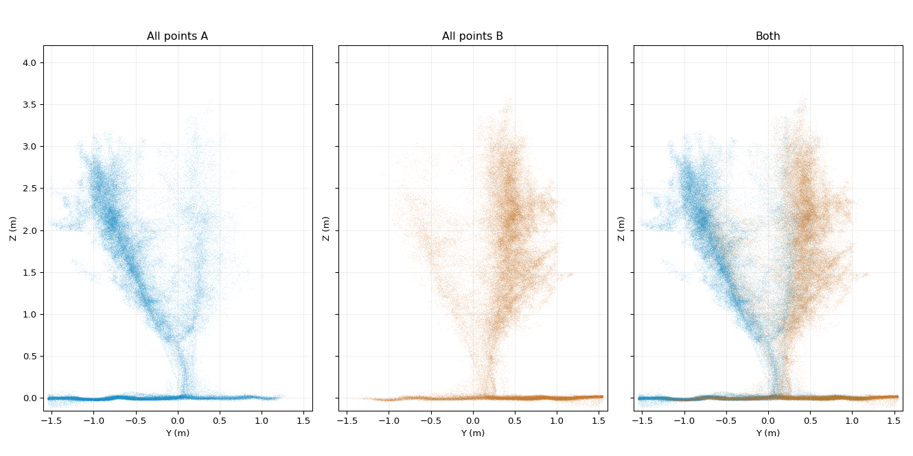
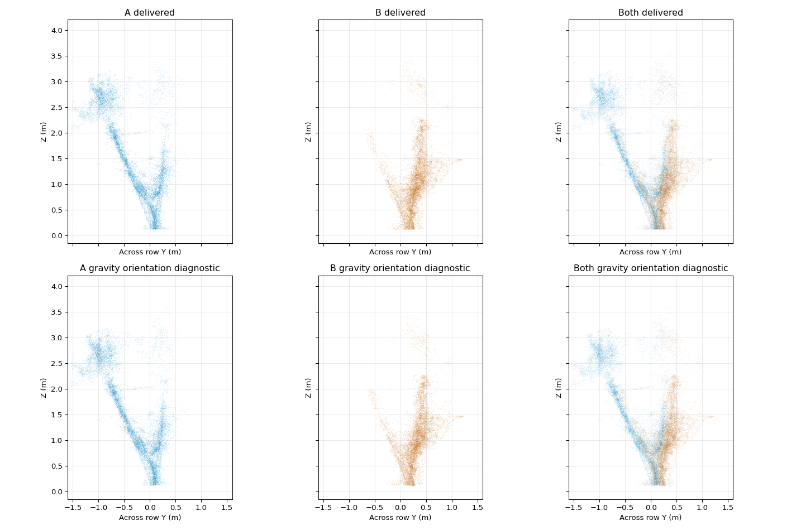

# Full-height registration checks without tree-shape templates

The requested outcome is a faithful rigid reconstruction. No V symmetry, equal branch angles, horizontal support bar, vertical trunk, mirror operation, scale change or per-point deformation is an optimisation target. A known horizontal bar can diagnose an orientation problem; it is not silently made horizontal.

The V-hedge orientation concern is **not yet resolved**. This change adds a reusable diagnostic and reports the evidence. It does not promote a new V-hedge pose, change the accepted spindle poses, expand the chandelier crop or rebuild meshes.



Blue is side A, orange is side B. These are orthographic Y–Z projections in metres with equal axis scales, using all returns. They avoid perspective and green/brown selection as explanations for the profile, but still superimpose different trees and occluded surfaces.

## What the checks found

1. The delivered V-hedge gravity-levelled sensor up directions are tilted **0.42–1.67 degrees** relative to exported Z. The within-side registration and relative ground stage can change roll/pitch after IMU levelling. Undoing this tilt, while retaining yaw, does not remove the asymmetric observed profile. That is a diagnostic experiment, not a validated alternative pose.
2. Re-decoding all 13 usable original V-hedge PCAPs with the final orchard ROI, without the early sensor-forward 0.35–3.15 m gate, recovers **14,979 representative 1 cm cells**, of which **690 are above 0.5 m**. Most recovery is ground. This experiment leaves the profile essentially unchanged. These are exploratory cell counts in merged coordinates, not an exact count of additional points in a production export.
3. A trial rigid refinement used same-facing wood geometry above 0.55 m and a gravity prior. The exploratory cross-side residual RMS worsened from **24.6 to 25.3 mm**. Its median improved, illustrating why median alone is insufficient. The experiment is rejected; it is not an independent accuracy benchmark or a published final cloud.
4. The more conservative checker selects a spatial validation subset before matching, with both endpoints in that subset. It checks frozen pair identities before and after a proposed correction. Under its defaults, the V-hedge matched height coverage is insufficient to certify upper-structure orientation. The proposed correction also degrades matching residuals: on 144 retained same-face matches, point-to-plane RMS rises from 22.2 to 24.0 mm and Euclidean RMS from 34.9 to 41.0 mm. Only two height bands have at least 30 matches; the default requires three. Sparse support under these gates does **not** prove that the data contain no recoverable structural information or that the existing pose is correct.



Top: delivered geometry. Bottom: removal of each recording's accumulated roll/pitch about a low pivot, retaining yaw. The bottom row is deliberately **not promoted**: restoring gravity alone is not a complete registration solution.

Yaw rotates X/Y and leaves point heights unchanged. A genuine height slope in a shared straight bar requires checking roll/pitch, object identity, scan blending and projection as well as yaw. A flat-looking soil sheet does not settle those questions: matching soil patches may constrain relative heights well while other pose directions remain weakly determined.

The [machine-readable trial report](../results/vhedge_orientation_trial.json) includes the rejected correction matrices; [coverage summaries](../results/structural_alignment_summary.json) are also available.

## Reusable validator

`captures.structural_validation.validate_structure(...)` accepts already registered per-recording point arrays, saved wood scores, scanner origins, side labels and proposed rigid corrections. It does not import meshing or modify input arrays. The conservative, configurable gates:

- use provisional wood scores as a material cue, not botanical truth;
- select validation points in 3D spatial cells, excluding low-trunk fitting heights;
- estimate normals within the validation subset, facing the originating scanner;
- require reciprocal close neighbours and compatible oriented normals, so opposite bark hemispheres are not pulled together as coincident surfaces;
- freeze correspondence identities for before/after evaluation;
- report same-side and cross-side point-to-plane and Euclidean residuals, separate height bands and vertical support;
- reject non-rigid transformations, excessive residual degradation and insufficient support.

The caller must exclude the **same spatial validation cells at both endpoints** of its fitting correspondences. The validator cannot make a previously fitted candidate statistically independent after the fact. The exploratory trial above is not used to claim such independence.

The present function is a **validator, not a new full-height optimiser**. It supplements low-trunk checks; it does not establish upper-structure accuracy when common same-face returns are scarce. Cylinder/line landmark association across opposite surfaces remains a possible next source of independent constraints; those landmarks would need measured, freely fitted axes and radii rather than prescribed V geometry.

Audit a Current collection unpacked into `pointclouds/`, `transformations/` and `contributions/`:

```bash
python tools/check_structural_alignment.py \
  --stage /path/to/unpacked_collection \
  --dataset vhedge \
  --output /path/to/QC/vhedge/structural_alignment
```

To check a proposed correction, add `--corrections proposed_corrections.npy` (N×4×4 in scan-manifest order). The command writes JSON and an orthographic profile only. Identity checks in a coverage audit are explicitly labelled: a zero before/after change does not prove correct registration.

Current release builds add this coverage audit under `90_QC.zip → QC/<dataset>/structural_alignment/`, preserving the existing five-download layout. The primary PLYs, transformations, registered contributions and meshes are unchanged by the audit.

## Chandelier X boundary

The delivered chandelier inputs were cropped at **X = −0.5…6.6 m**, **Y = 1.2875…2.6875 m**, and **Z = −0.12…4.5 m**. The anchored export repeats this crop and explicitly notes that previously excluded returns cannot be recovered from those PLYs. Thus the visible X cutoff has a concrete export cause. A proper fix must re-export original measurements through the accepted poses with a wider reviewed tree-row ROI, then independently rebuild the matching mesh. Padding, stretching or extrapolating the current cloud cannot recover those measurements. That ROI/mesh change is not part of this diagnostic update.

## Validation

Synthetic checks cover a tilt that is invisible at ground level but wrong at height, correct alignment of deliberately asymmetric geometry, rejection of opposite-facing nearby surfaces, and rejection of scale changes. They supplement the existing registration, attribute-preservation and release checks. All metrics are internal, conditional on source acquisitions and matching choices, not independent survey accuracy.
