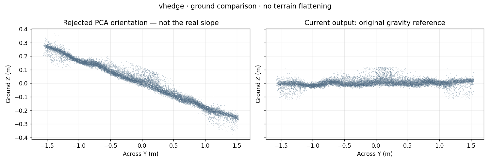
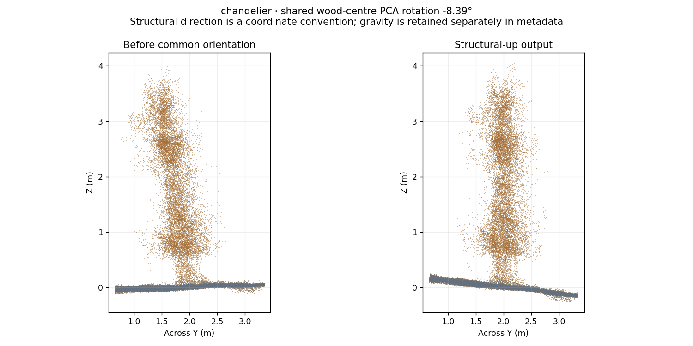
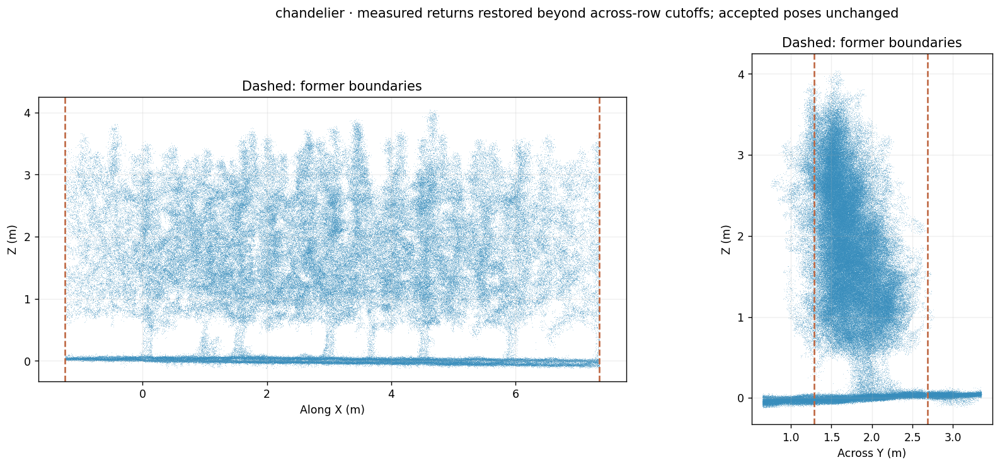

# PCA orientation trial withdrawn; wider chandelier coverage retained

The PCA rotations of **−10.33° for V-hedge** and **−8.39° for chandelier** are withdrawn. They rotated the entire scene and created a displayed ground slope that is inconsistent with the slight real slope reported in the field. Current outputs restore the original gravity-referenced registration frame. This restores the preceding orientation; it does **not** resolve the remaining V-hedge slant.

## Why the PCA trial failed

A woody height-centre PCA axis estimates the direction of visible structure, not gravity. Growth direction, occlusion and provisional wood labels can bias it. Statistical consistency across tree windows does not establish physical vertical. A common rotation preserves inter-scan residuals, so good trunk-registration scores cannot validate that rotation either.

The rejected trial selected provisional wood returns, balanced height bins and opposing views within row windows, fitted PCA to median height-centre paths, and bootstrapped the window estimates. Those diagnostic calculations remain available in `captures/structural_frame.py`. They cannot change primary data during normal release generation. `tools/orient_collection.py` defaults to diagnostic-only operation and first restores any former PCA export from the immutable baseline. The optional `--research-structural-frame` flag is an explicit coordinate-frame experiment, not part of the release pipeline.

The plots below compare the rejected PCA ground orientation with the restored working frame. Both panels use the same measured ground-return identities. The ground is not newly flattened, and no new physical slope is inferred from these plots.

## What is retained

The accepted relative registration, including the joint V-hedge fit and its recovered recording, is retained. Spindle trunk refinements are unchanged. Trunks remain free to lean; no V-symmetry or upright-growth constraint is introduced. Physical-up uncertainty must be investigated using stationary IMU information and calibration rather than another cosmetic global rotation.

Chandelier’s measured across-row ROI remains **Y=0.65…3.35 m**, expanded from **1.2875…2.6875 m**. X remains **−1.25…7.35 m**, with height range **−0.12…4.5 m** in the restored working frame. Original PCAP returns were decoded directly into this ROI, bypassing the obsolete sensor-forward gate. Accepted sensor poses and the shared colour model were retained.

The primary chandelier cloud contains **1,527,905 measured points**, adding **201,026** to the preceding X-expanded result. Every former sample is retained as an exact prefix before/after restoring the working frame. No intensity, NIR, reflectivity, RGB, scan, frame or pixel identity is changed by orientation restoration.

The matching independent voxel/SDF mesh retains **609,606 triangles**. Its closed canopy envelope passes closed-edge, vertex-manifold and orientability checks; the separate ground sheet is open. The mesh is restored byte-for-byte from the wider-ROI baseline and its quality report hashes the current source PLY. A global triangle self-intersection search is not performed.

## Downloads and verification

Use the existing [Current release](https://github.com/u0063882/GreensprayAI/releases/tag/current). Download fresh 01–03 and 91 archives together. All final clouds, contributions, matrices and mesh use the restored working frame. No additional asset list is introduced.

`QC/<dataset>/structural_frame/report.json` records zero applied rotation, `automatic_structural_rotation_enabled=false`, and the rejected PCA diagnostic estimate. The former PCA field is removed from current transformation metadata. `structural_frame_baseline.zip` preserves the accepted pre-PCA XYZ, matrices and mesh. Chandelier’s earlier ROI baselines remain in QC for provenance.

Regression checks exercise explicit research-frame round trips, source-attribute preservation and default restoration even when the diagnostic estimator reports a strong PCA direction. Real-data verification compares every restored point coordinate and raw-attribute digest with the wider-ROI/joint baseline, checks all sensor matrices, and verifies mesh bytes and the current source-cloud hash. Relative registration quality is distinct from absolute orientation accuracy; the latter remains under investigation.

## Subsequent independent raw-source check

The [original-PCAP angle audit](raw_geometry_audit.md) now measures the east and west tracks separately with IMU rotation only. It finds the visible profile difference before registration, with ground-plane tilts around 1–2°. This supports retaining the physical working frame; it does not establish exact biological branch angles.
