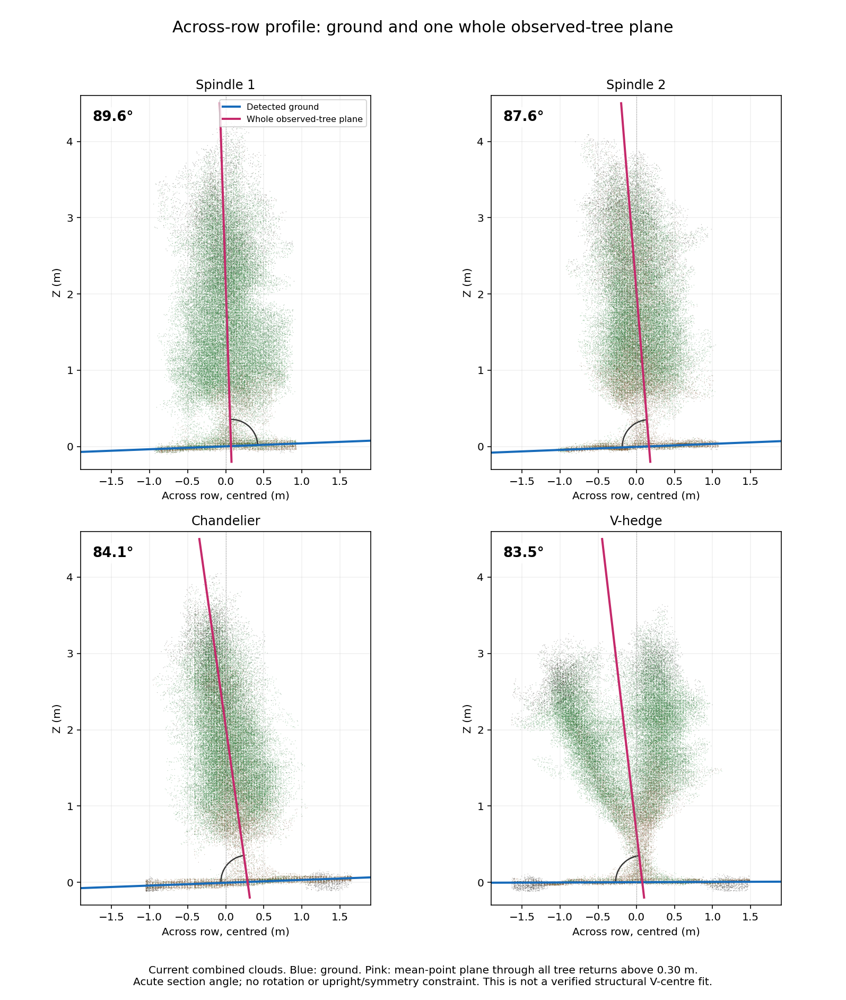
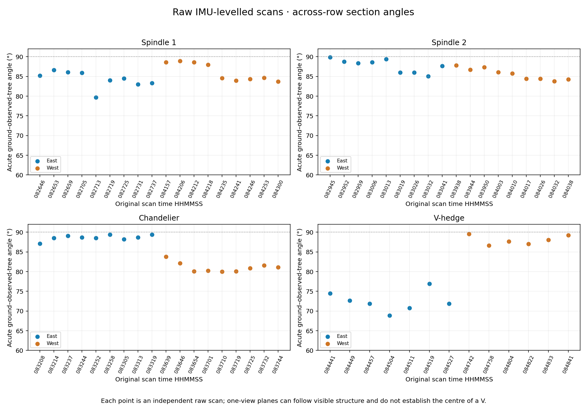

# Across-row ground / observed-tree plane check

The requested view is **Y–Z in the exported clouds**, with X along the row. This read-only diagnostic leaves every point, mesh and transformation unchanged. These are **acute section angles**, where 90° means perpendicular; they are not the full 3D plane dihedrals.



| System | Current combined cloud | Raw east median | Raw west median | Usable raw scans |
| --- | ---: | ---: | ---: | ---: |
| Spindle 1 | 89.6° | 84.5° | 84.6° | 18 |
| Spindle 2 | 87.5° | 88.3° | 85.7° | 18 |
| Chandelier | 84.1° | 88.7° | 80.9° | 18 |
| V-hedge | 83.5° | 71.9° | 87.9° | 13 |

**Interpretation:** a single statistical plane passes through all observed tree returns in each input. Both V arms remain included when observed; no arm is deliberately selected or discarded as an outlier. Nevertheless, a scan with strongly unequal arm visibility can have its plane pulled towards the near arm. This is **not a verified biological centre-plane measurement**, and the east/west differences alone cannot distinguish occlusion, actual shape, IMU calibration or registration error. The earlier 82.3° structural-centre claim remains [withdrawn](raw_geometry_audit.md).



## Every original scan

- [All 67 angles, plus 2 excluded inputs (CSV)](QC/tree_ground_angles/every_scan_angles.csv)
- [Combined-cloud angles (CSV)](QC/tree_ground_angles/combined_angles.csv)
- [Full parameters, source hashes, status and limitations (JSON)](QC/tree_ground_angles/tree_ground_angles.json)
- [Spindle 1: every raw scan with fitted lines](QC/tree_ground_angles/spindle1_every_raw_scan.png)
- [Spindle 2: every raw scan with fitted lines](QC/tree_ground_angles/spindle2_every_raw_scan.png)
- [Chandelier: every raw scan with fitted lines](QC/tree_ground_angles/chandelier_every_raw_scan.png)
- [V-hedge: every raw scan with fitted lines](QC/tree_ground_angles/vhedge_every_raw_scan.png)

The CSV records original scan IDs, independently inferred geographic sides, plane-to-ground angle, signed tree lean and ground slope, residuals, frame completeness and row-axis method. A/B labels are not assumed to denote the same physical side across systems.

Spindle 2 scans A `083019`, A `083032` and B `083950` have insufficient separately resolved low stems. Their **horizontal azimuth only** uses a canopy XY principal-axis fallback, requiring horizontal eigenvalue ratio above 3. This is flagged as `horizontal_canopy_PCA_fallback`; it does not infer or constrain vertical tree direction. V-hedge A `084742` is an exact duplicate and B `084751` lacks IMU; both are explicitly excluded, without an invented angle.

## Method and reproduction

Original scans use factory XYZ and the original median IMU leveling rotation, with one frame selected by maximum column completeness. There are no fitted registration poses, terrain flattening, learned IMU corrections, or symmetry/upright targets in the raw check. Local row axes come from low-stem/support candidates, with the flagged fallback above. A horizontal coordinate rotation and translation make each scan's across-row profile east-positive, with a local ground-height datum. These plotting coordinates do not alter or export the source cloud.

Ground detection uses RANSAC followed by robust slope fitting. Tree fitting uses one ordinary least-squares plane `Y = a*X + b*Z + c`, including all observed tree points 0.30–4.50 m above the local ground. A 40 mm spatial sample retains actual returns to reduce density weighting. No robust tree rejection is used, because a second V arm must not be discarded as an outlier. The displayed lines are sections of the two fitted planes at the median along-row X. The cloud is projected across the row, so residual spread also includes real structure and variation along the row.

Different visible coverage and ROIs mean raw/final angle differences are not a controlled registration-accuracy comparison. The combined-cloud JSON hashes identify the exact current PLY snapshots used here; future geometry changes require rerunning this diagnostic. Absolute RTK positions are omitted.

```bash
python tools/check_tree_ground_angles.py \
  --collection /path/to/current_collection \
  --data-roots /path/to/spindle1/data /path/to/spindle2/data /path/to/chandelier/data /path/to/vhedge/data \
  --output /path/to/angle_diagnostics
```

`current_collection/pointclouds/<dataset>/final_registered.ply` supplies the four combined clouds; each original-data directory has `sideA` and `sideB` subfolders with PCAP/JSON/H5 triples. Registration and meshing are not invoked.
