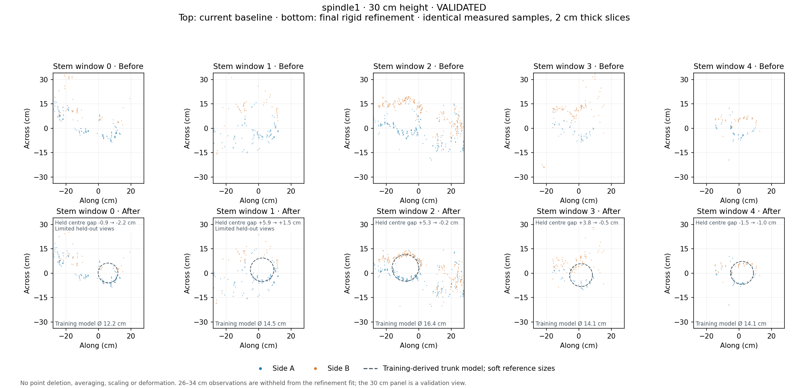
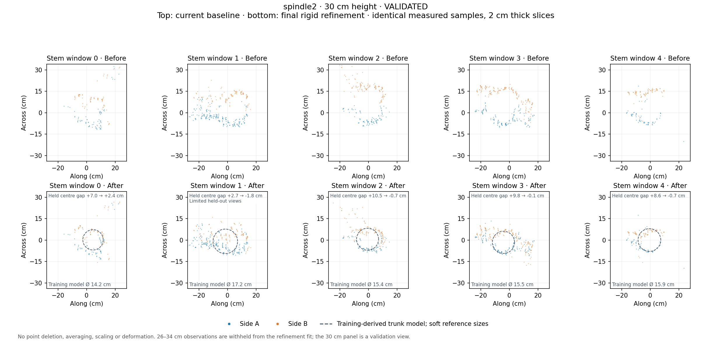

# Final trunk refinement — measured-reference comparison

The spindle outputs described here remain current. V-hedge subsequently received the [joint rigid refinement](joint_registration_report.md); chandelier subsequently received a measured X-ROI extension and matching mesh rebuild. The V-hedge/chandelier comparisons below describe the earlier trunk-only stage.

The refinement is a final, independent step on the existing registration. Spindle 1 and Spindle 2 pass the acceptance checks and become the primary results. Chandelier and V-hedge retain their previous primary results; their flagged candidates are preserved in QC.

The user confirmed representative measurements, with no correspondence between spreadsheet tree numbers and scan windows. Loose netting can affect circumference. Reference ranges inform object association and per-stem radius priors; they are not exact assigned sizes.

## Conditional held-out checks

The 26–34 cm geometric band is withheld from fitting. Each before/after comparison uses the same detected objects and cross-side pairs. Values are internal, size-conditioned centre agreement, not independent survey accuracy.

| Dataset | Across median before → after | Across RMS before → after | Ground median before → after | Along displacement RMS | Primary result |
| --- | ---: | ---: | ---: | ---: | --- |
| spindle1 | 47.0 → 8.3 mm | 50.5 → 14.9 mm | 11.4 → 10.8 mm | 3.9 mm | Refined |
| spindle2 | 97.5 → 10.0 mm | 96.8 → 16.9 mm | 8.1 → 7.0 mm | 3.6 mm | Refined |
| chandelier | 19.9 → 13.3 mm | 27.1 → 20.8 mm | 7.4 → 7.4 mm | 5.3 mm | Baseline retained |
| vhedge | 24.5 → 16.6 mm | 49.1 → 33.6 mm | 8.2 → 8.5 mm | 11.4 mm | Baseline retained |

## spindle1 — all configured windows at 30 cm

Top: baseline. Bottom: final refinement. A blue, B orange; 2 cm thick slices and common centimetre axes. The circles are training-derived models, not measured bark boundaries. Weak or absent held-out comparisons are labelled in the panels.

Recordings left at their baseline pose for insufficient landmark support: [7, 17].

Limited-view held-out objects (do not read them as strong accuracy evidence): trunk window 0, trunk window 1.

## spindle2 — all configured windows at 30 cm

Top: baseline. Bottom: final refinement. A blue, B orange; 2 cm thick slices and common centimetre axes. The circles are training-derived models, not measured bark boundaries. Weak or absent held-out comparisons are labelled in the panels.

Limited-view held-out objects (do not read them as strong accuracy evidence): trunk window 1, post window 2.

## Retained candidates

chandelier: A recording reaches its correction limit: 9. The candidate remains in QC; primary data is unchanged.

vhedge: Held-out trunk 1 worsens by more than 5 mm. The candidate remains in QC; primary data is unchanged.

## Preservation and reproducibility

Every input measured sample, source order, Z value, raw intensity/SIGNAL, NIR, reflectivity, source index and shared Lab RGB is retained. New matrices are final correction × original baseline matrix. Original primary PLYs/matrices and per-recording XYZ are preserved in each dataset’s `trunk_refinement_baseline.zip` under QC provenance. Rebuilding starts from that archive, avoiding double application.

The refinement moves each recording rigidly, with across translation and yaw. It does not scale or deform individual trunks. Some observations remain uncertain, and the representative size priors do not establish absolute ground-truth centres. See [method, reference ranges and checks](trunk_refinement.md).
